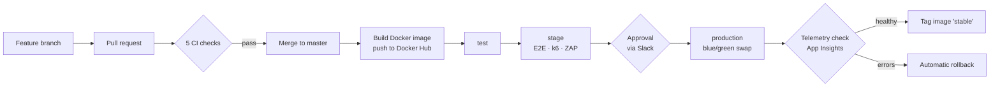

# CI/CD Pipeline with Automatic Rollback: Blood Pressure Calculator

A complete continuous delivery pipeline for a small Python web app, built with **GitHub Actions**, **Docker** and **Azure App Service**. Every change goes from a feature branch through automated checks, three environments and an approval gate to production. If production looks unhealthy after a release, the pipeline **rolls back on its own**.

Built for the *Continuous Software Deployment* module of the MSc in Computing (DevOps) at TU Dublin.

| 96% | 84 + 21 | 110 ms | 0 | 28 |
|:---:|:---:|:---:|:---:|:---:|
| test coverage | unit + BDD tests | p95 under load (k6) | ZAP high/medium/low alerts | pull requests shipped |

**Links:** [Latest k6 load-test report](https://pso25.github.io/SoftwareDelivery_bp_ca1/k6/latest/) · [Live app](https://ca1-czfbfmf2dhaxhger.austriaeast-01.azurewebsites.net)

---

## How a change reaches production

## What runs where

| Stage | What runs | Fails the build if |
|---|---|---|
| **Pull request (CI)** | pytest + coverage, pytest-bdd, Ruff, Bandit, pip-audit, Hadolint, container smoke test, Trivy | A test fails, coverage drops below 80%, or the image has a critical fixable vulnerability |
| **test** | Deploy the image and run a health check | The app doesn't come up healthy |
| **stage** | Playwright E2E, k6 load test, OWASP ZAP scan | p95 > 1 s, > 1% failed requests, or E2E failures (ZAP reports for a human to review) |
| **Approval** | Results posted to Slack and a reviewer approves in GitHub | Nobody approves |
| **production** | Blue/green deploy with slot swap, health check, telemetry check | Server errors or exceptions appear in Application Insights, which triggers an automatic rollback |

## Reliability features

- **Automatic rollback:** after go-live, the pipeline sends test requests and checks Application Insights for server errors and exceptions. If it finds any, it redeploys the last image tagged `stable`. I tested this by deliberately shipping a faulty release (PR #29): it passed CI and stage, failed the production telemetry check, and was rolled back automatically.
- **Manual recovery:** separate Rollback and Undo Swap workflows, both protected by approval.
- **Disaster recovery:** a Terraform workflow builds a full copy of the site in a second Azure region (Spain Central) on demand, with state stored in Azure Storage, and tears it down when no longer needed.
- **Safe releases:** a shared lock stops deploys, rollbacks and undos running at the same time.

## Security

- **Keyless login to Azure with OIDC** for production: no stored passwords.
- Security checks at every stage: Bandit and pip-audit for code, Hadolint and Trivy for the container, and OWASP ZAP against the running site.
- Issues found by the pipeline and fixed: missing security headers, outdated jQuery libraries and cacheable pages with health data.
- Telemetry records only the blood pressure **category**, never the readings themselves.

## Tech stack

| Area | Tools |
|---|---|
| CI/CD | GitHub Actions, GitHub Environments, Docker Hub |
| Hosting | Azure App Service (deployment slots) |
| Testing | pytest, pytest-cov, pytest-bdd, Playwright, k6 |
| Security | Ruff, Bandit, pip-audit, Hadolint, Trivy, OWASP ZAP |
| Monitoring | OpenTelemetry, Azure Application Insights, Slack |
| Infrastructure as code | Terraform |

## Repository layout

| Folder | Contents |
|---|---|
| `.github/workflows/` | CI checks, build-and-deploy pipeline, rollback, undo swap and disaster recovery workflows |
| `BPCalculator_Python/` | The Python app (migrated from the original ASP.NET version) and its tests |
| `DR-Automation/` | Terraform for the disaster recovery site |
| `BPCalculator/` | The original ASP.NET Core version from the module's starter repo |

## Known limitations and next steps

- Test and stage still use publish profiles; next step is to move every environment to OIDC.
- Trivy reports high-severity issues in the Debian base image; next step is a slimmer base image and updated packages.
- The telemetry check only watches the release window; next step is continuous alerting after release.
